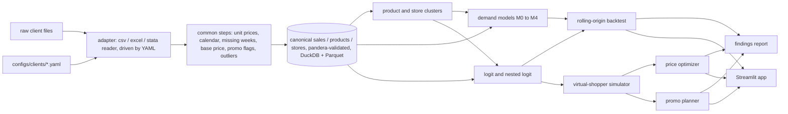

# Shelf Simulator

Onboards retailers' weekly scanner data into one canonical schema, estimates price elasticities five ways, simulates shoppers choosing between products, and recommends prices and promos under business rules. Built on public data (Dominick's Finer Foods and dunnhumby). It's my own take on retail pricing analytics, not a copy of any vendor's method.

Demo: TODO (link once deployed)

TODO: GIF of the scenario simulator

## Backtest results

<!-- backtest:start -->
Rolling-origin backtest, Dominick's Finer Foods (cereal): 4 folds of 13 weeks, held-out weeks starting 1996-05-09 to 1997-05-01. Units are store x product x week units.

| Model | Client | WAPE all | WAPE promo | WAPE chain-week | Bias | MASE | Direction accuracy | Promo-lift calibration | Elasticity sd across folds | Plausibility |
|---|---|---|---|---|---|---|---|---|---|---|
| M0 naive | client_b | 58.7% | 82.4% | 43.8% | -43.3% | 1.00 | n/a | n/a | n/a | n/a |
| M1 log-log | client_b | 63.3% | 83.5% | 36.4% | 8.7% | 1.08 | 85.6% | 1.15 | 1.50 | 69.6% |
| M2 cross-price | client_b | 60.8% | 79.9% | 34.5% | 4.9% | 1.04 | 85.2% | 1.04 | 1.20 | 73.2% |
| M3 hierarchical | client_b | 59.8% | 79.3% | 33.4% | 3.2% | 1.02 | 85.3% | 1.01 | 1.18 | 74.1% |
| M4 LightGBM | client_b | 52.7% | 64.3% | 23.0% | -12.2% | 0.90 | 83.6% | 0.65 | 0.05 | 2.7% |
| Nested logit | client_b | 62.7% | 73.9% | 29.8% | -4.4% | 1.07 | 84.5% | 0.75 | 1.76 | 86.6% |

dunnhumby Breakfast at the Frat (cold cereal), same setup, held-out weeks starting 2011-01-06 to 2011-12-29:

| Model | Client | WAPE all | WAPE promo | WAPE chain-week | Bias | MASE | Direction accuracy | Promo-lift calibration | Elasticity sd across folds | Plausibility |
|---|---|---|---|---|---|---|---|---|---|---|
| Model | Client | WAPE all | WAPE promo | WAPE chain-week | Bias | MASE | Direction accuracy | Promo-lift calibration | Elasticity sd across folds | Plausibility |
| M0 naive | client_a | 42.3% | 58.6% | 24.1% | -22.3% | 1.00 | n/a | n/a | n/a | n/a |
| M1 log-log | client_a | 32.5% | 35.5% | 8.7% | -0.6% | 0.77 | 68.4% | 1.07 | 0.36 | 85.0% |
| M2 cross-price | client_a | 33.4% | 37.4% | 10.2% | 0.6% | 0.79 | 68.6% | 1.12 | 0.33 | 90.0% |
| M3 hierarchical | client_a | 32.7% | 35.7% | 9.1% | 0.0% | 0.77 | 68.5% | 1.08 | 0.41 | 81.7% |
| M4 LightGBM | client_a | 31.1% | 33.3% | 9.2% | 0.1% | 0.74 | 69.6% | 1.05 | 0.38 | 53.3% |
| Nested logit | client_a | 53.1% | 57.8% | 14.5% | 2.4% | 1.25 | 66.9% | 1.50 | 0.22 | 100.0% |

Sources: `outputs/client_b/backtest.md` and `outputs/client_a/backtest.md`, regenerated by `make backtest`.
<!-- backtest:end -->

## Architecture



Everything after the canonical tables runs the same for every client. A new client is a YAML file: `tests/onboarding/test_onboarding.py` onboards a fake third client, with grams, week-ending dates and one promo-type column, using only `tests/fixtures/configs/clients/client_c.yaml`. More in [docs/architecture.md](docs/architecture.md).

## Design decisions

- [ADR 0001](docs/adr/0001-canonical-schema.md): the canonical schema. Zero-sales weeks stay in as labelled rows; feature and display are nullable because one client doesn't report them.
- [ADR 0002](docs/adr/0002-base-price-method.md): regular price is the trailing 8-week max of non-promo prices, the same method for both clients, so regular-price elasticity and promo response are measured separately.
- [ADR 0003](docs/adr/0003-demand-model-family.md): the hierarchical Bayes model (M3) is the model of record for pricing. LightGBM forecasts best but barely responds to price.
- [ADR 0004](docs/adr/0004-evaluation-metric.md): WAPE, not MAPE, plus pricing-quality metrics (elasticity stability, plausibility, promo-lift calibration).
- [ADR 0005](docs/adr/0005-margin-assumption.md): client A has no cost data, so margin is assumed by brand tier from client B's observed margins.
- [ADR 0006](docs/adr/0006-market-size.md): choice-model market size, and why the optimizer maximizes margin by default.

What the raw files turned out to contain, and where they differ from what I expected: [docs/datasets.md](docs/datasets.md).

## What didn't work

TODO (yours)

## Run it locally

Needs Python 3.12 and [uv](https://docs.astral.sh/uv/).

```
make setup
# put the raw files in data/raw/client_b/ (and data/raw/client_a/), see docs/datasets.md
make onboard CLIENT=client_b
make cluster CLIENT=client_b
make model CLIENT=client_b
make backtest CLIENT=client_b
make simulate CLIENT=client_b
make report CLIENT=client_b
make app
make lint test
```

Outputs land in `outputs/client_b/`: `data_quality.html`, `clusters.html`, `elasticities.csv`, `backtest.md`, `findings.html` and the files behind them. The app reads only `outputs/deploy/`, which holds model outputs and aggregates, never raw rows. Write the findings summary and recommendation in `docs/findings/<client>.md` and rerun `make report`.

## Data credits and terms

- Dominick's Finer Foods data: James M. Kilts Center for Marketing, University of Chicago Booth School of Business. Free for academic research. Raw files are not redistributed here.
- "Breakfast at the Frat": dunnhumby source files, free with registration. Raw files are not redistributed here.

Only model outputs and aggregated tables are committed (`outputs/deploy/`); `tests/test_deploy.py` fails if anything at store x product x week grain ends up there.
