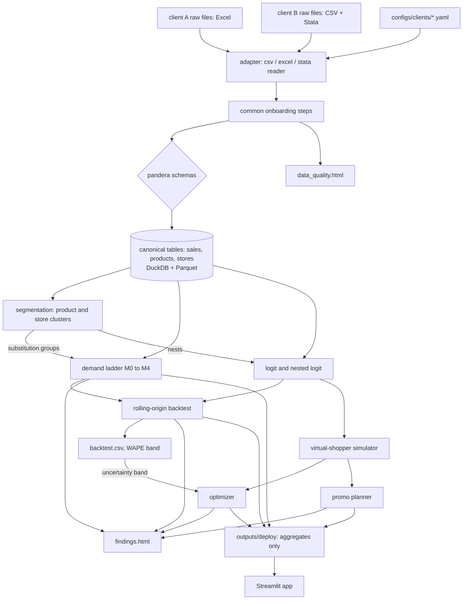

# Architecture

Shelf Simulator takes a retailer's weekly scanner data, maps it into one canonical schema, and answers pricing questions on top of that schema: how sensitive each product is to price, where volume goes when a price moves, and which price or promo plan earns the most.

The one rule that shapes everything: client-specific code stops at the canonical tables. A client is a YAML file in `configs/clients/`. Nothing after onboarding knows which client it's looking at.

## Data flow

## Layers

### Onboarding (`shelfsim.onboarding`)

The adapter (`onboarding/adapters/__init__.py`) reads one raw file with a csv, excel or stata reader and renames its columns to the names the steps expect. Which file, reader, sheet and columns all come from the YAML, so the spec's planned `client_a.py` and `client_b.py` turned out unnecessary: both clients, and the fake third client in the tests, use the same three readers. The adapter doesn't fix units, fill gaps or derive prices, because if each client's adapter did that, the two clients would be cleaned differently and their elasticities wouldn't be comparable.

Client quirks that need logic are SQL expressions in the YAML, evaluated by the common steps: row filters (`ok = 1`), promo codes (`sale IN ('B', 'C', 'S')`), the private-label rule and the cost formula. Manufacturer from a UPC prefix, store segments from a lookup and size overrides are YAML maps.

The shared steps in `steps.py` run in a fixed order for every client:

1. Unit fixes: bundle prices to unit prices, sizes to ounces.
2. Calendar: client week numbers to `week_start` dates.
3. Missing weeks: fill the store x product x week grid and label each row observed, zero_sales or not_carried.
4. Base price: one estimation method for both clients.
5. Promo flags: raw codes to `on_feature`, `on_display`, `on_price_cut`, and `discount_depth = 1 - unit_price / base_price`.
6. Outliers: flag, never delete.
7. Validate against `schema.py`, then write DuckDB and Parquet.

`quality.py` records row counts after each step and writes `outputs/<client>/data_quality.html`. That report is what goes back to the client with open questions in week one. `docs/datasets.md` has what the raw files turned out to contain.

### Canonical schema (`shelfsim.schema`)

Three tables, defined as pandera schemas. Nothing is written without passing them.

| Table | Grain | Holds |
|---|---|---|
| sales | client x store x product x week | units, revenue, actual and regular price, promo flags, discount depth, unit cost, row status, outlier flag |
| products | client x product | name, brand, manufacturer, category, size in ounces, private label flag |
| stores | client x store | segment, region, any demographic columns the client has |

ADR 0001 has the reasoning per column.

### Segmentation (`shelfsim.segmentation`)

Product clusters (price per ounce, size, brand tier, discount depth, promo frequency) and store clusters (segment, basket, price index, promo response). Product clusters are reused twice: as the substitution groups for cross-price terms in the demand models, and as the nests in the nested logit.

### Demand models (`shelfsim.demand`)

Every model implements the interface in `base.py`: `fit(train) -> model` and `predict(model, frame) -> units`, plus elasticity extraction. That interface is what lets the backtest treat them all the same.

| Model | Role |
|---|---|
| M0 naive | trailing 4-week mean of non-promo weeks; the baseline |
| M1 log-log OLS | per product, elasticity is the coefficient on ln(base price) |
| M2 pooled cross-price | M1 pooled by cluster plus the average price of the other products in it |
| M3 hierarchical Bayes | product elasticities partially pooled toward a cluster mean |
| M4 LightGBM | forecasting benchmark; elasticity by perturbing price 5% |

### Choice model and simulator (`shelfsim.choice`)

Each store-week is a market with an outside option; market size is in ADR 0006. The plain logit and nested logit are fitted with the Berry inversion. The simulator draws virtual shoppers per store cluster with their own price sensitivity and aggregates their choices, which is how a scenario turns into units, revenue, margin and "where the volume went".

### Evaluation (`shelfsim.evaluation`)

Rolling-origin backtest: train to week t, forecast 13 weeks, step 13, at least 4 folds, never shuffled. Metrics are WAPE, bias, MASE against M0, promo-lift calibration, direction accuracy on price changes, elasticity stability across folds and plausibility rate. All split by promo and non-promo weeks.

### Optimization and promo planning (`shelfsim.optimize`, `shelfsim.promo`)

The optimizer searches prices with the simulator as its objective, under the constraints in `configs/modeling.yaml`: a ±10% band, price ladders, .x9 endings and a cap on category volume loss. The gain is reported with a band from backtest WAPE. The promo planner compares mechanics for one product.

### Outputs

`outputs/<client>/` holds everything a run produces. `outputs/deploy/` holds the aggregates and model outputs the Streamlit app reads, and never raw rows, because neither dataset may be redistributed.

## Running it

`python -m shelfsim <step> --client <client>` runs one step; the Makefile wraps it. Steps run in this order, each reading the previous one's outputs:

| make target | Writes to outputs/<client>/ |
|---|---|
| onboard | data_quality.html (and the canonical tables in data/) |
| cluster | product_clusters.csv, store_clusters.csv, silhouette_*.csv, clusters.html |
| model | elasticities.csv, cross_elasticities.csv |
| backtest | backtest.csv, backtest_summary.csv, backtest.md, and outputs/model_comparison.md |
| simulate | choice_models.json, logit_elasticities.csv, simulator.json, promo_plan.csv, optimizer.json |
| report | findings.html, and outputs/deploy/<client>/ |

## Config

| File | Owns |
|---|---|
| `configs/clients/<client>.yaml` | file paths, column mapping, units, promo code mapping, categories to keep, margin assumption |
| `configs/modeling.yaml` | split dates, backtest horizon, plausibility range, optimizer constraints |

`shelfsim.config` loads both into pydantic models, so a typo in a YAML key fails at load time instead of halfway through a model fit.

## Storage

`data/shelfsim.duckdb` holds the canonical tables for all clients, keyed by `client_id`. Each table is also written to Parquet so notebooks and the app can read it without DuckDB. `data/` is gitignored.
